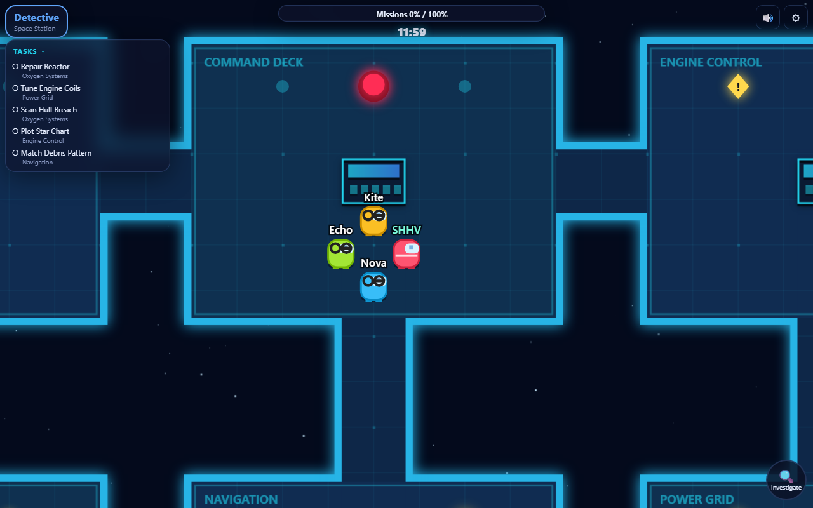
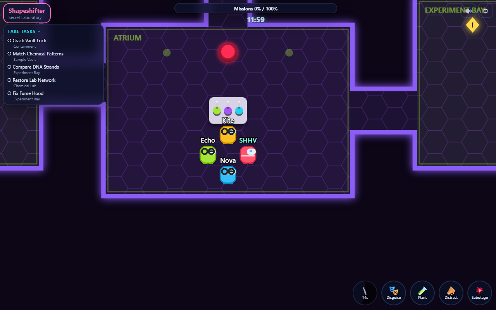
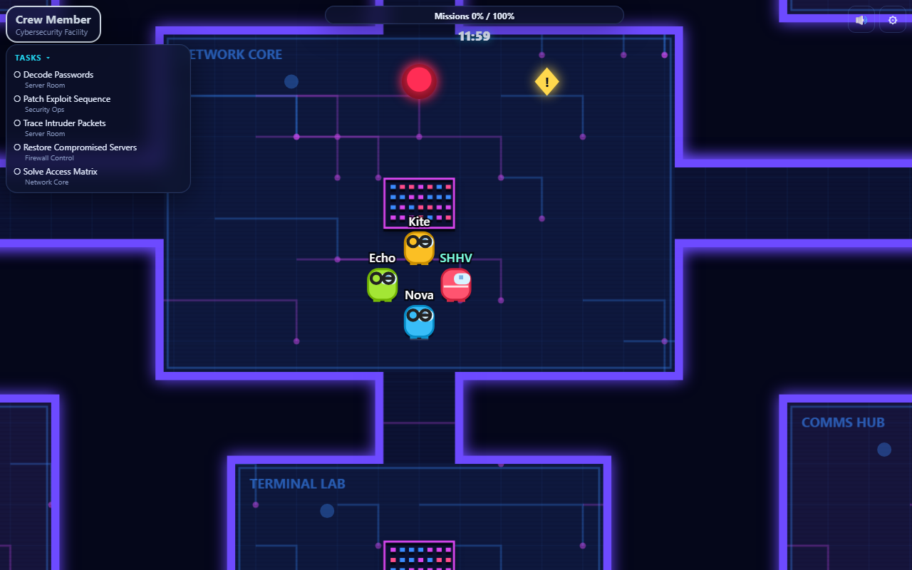
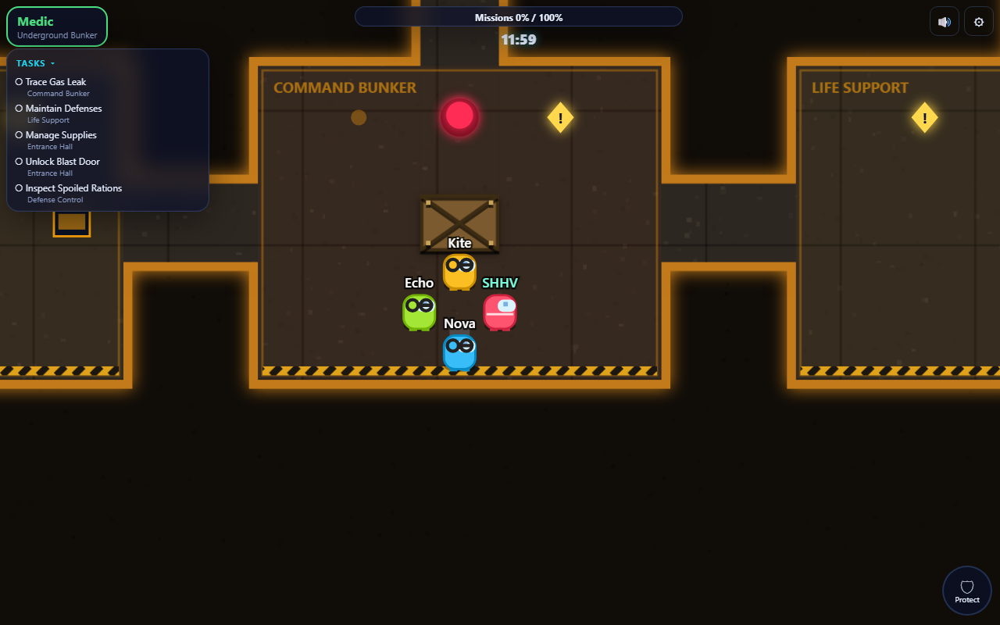
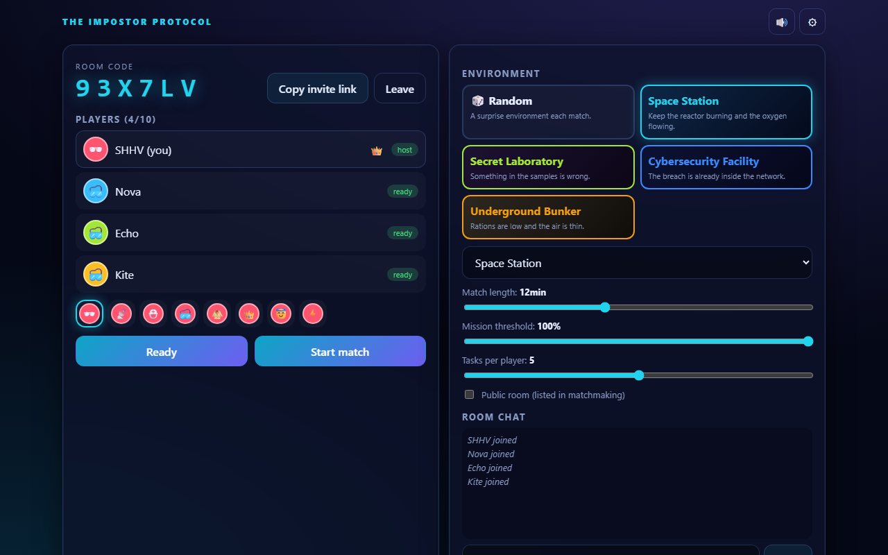
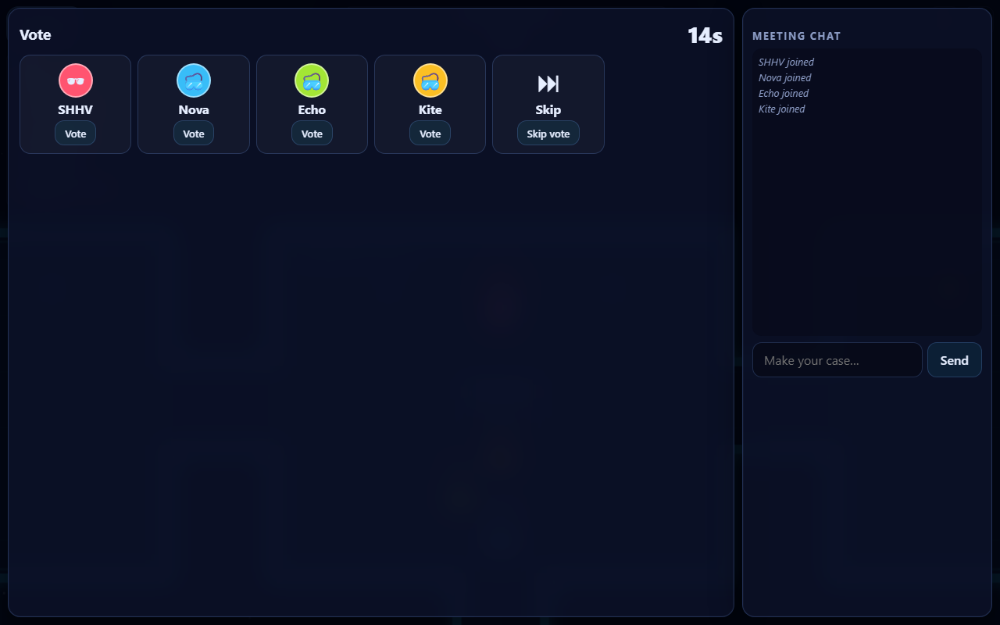
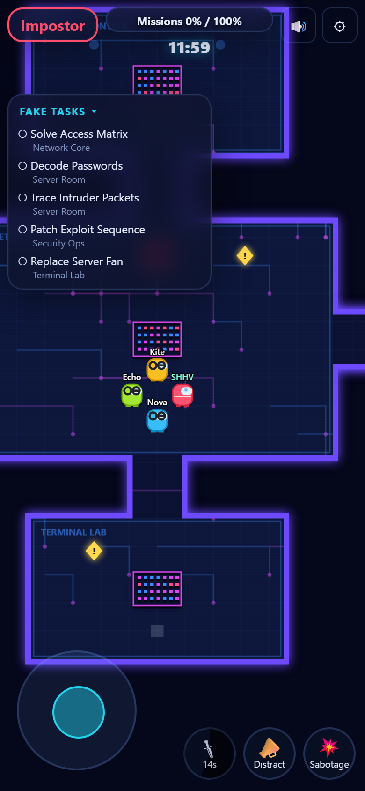

# The Impostor Protocol

A real-time multiplayer social deduction game for 4–10 players, playable in any modern browser on phones, tablets and desktops. Crew members finish missions and repair sabotage while hidden impostors eliminate them; meetings, discussion and voting decide who survives.

No accounts: players get a guest profile (XP, stats, achievements) automatically.

**Live demo (GitHub Codespaces):** https://hidden-apparition-4qvqgxp64x76f5rgg-3000.app.github.dev

This is a temporary demo, not a permanent host: it runs only while the owner's codespace is running (it stops after about an hour of inactivity), progress is held in memory and resets on restart, and GitHub shows a one-time "development port" warning on first visit; click **Continue**. Verified with four separate browsers (lobby, match start, private roles, synced movement). For a permanent deployment with PostgreSQL see [Deployment](#deployment).

## Screenshots

| Space Station | Secret Laboratory |
| --- | --- |
|  |  |
| **Cybersecurity Facility** | **Underground Bunker** |
|  |  |

| Lobby | Meeting & voting | Phone |
| --- | --- | --- |
|  |  |  |

Title, landing and role-reveal screens: [`docs/screenshots/`](docs/screenshots).

## Features

- **Rooms:** public matchmaking, private rooms, six-character room codes, shareable invite links (`/?room=CODE`), room chat, ready states, host settings, host transfer, 60 s reconnection window, rematch.
- **Four environments** with their own layouts, art, missions and sabotage: Space Station, Secret Laboratory, Cybersecurity Facility, Underground Bunker (or Random).
- **Seven secret roles:** Detective, Engineer, Medic, Security Officer, Crew Member, Impostor, Shapeshifter. 1 impostor for 4–7 players, 2 (different variants) for 8–10. Roles are assigned on the server and only ever sent to their owner.
- **Missions:** logic, repair, hacking and investigation categories with seven real mini-games (sequence, circuit wiring, calibration, Caesar decoding, packet ordering, odd-one-out, pattern memory). Difficulty ramps through the match. The server generates each challenge, keeps the answer, enforces a minimum plausible solve time and validates the submission.
- **Sabotage:** critical countdown sabotage (impostors win if it expires), lights-out (server-side vision limiting), communications blackout (hides the mission meter), fake alerts (inflated meter), sealed rooms, environmental traps that eliminate players who linger.
- **Eliminations, meetings, voting:** proximity kills with cooldowns and Medic protection, body reports, emergency meetings, 60 s discussion, hidden votes revealed simultaneously, ties eject nobody. Eliminated players become spectators with a spectator-only chat.
- **Progression:** individual XP, team score, match leaderboard, persistent guest stats and eight achievements, all computed on the server.
- **Presentation:** animated title and role reveal, per-environment HUD and rendering, procedural WebAudio music, ambience and sound effects (no audio asset files), keyboard and touch controls.

## Game rules

| | |
| --- | --- |
| Players | 4–10 |
| Match length | 10–15 min (default 12), host configurable |
| Crew wins | shared mission meter reaches the threshold (default 100 %, host configurable 50–100 %) **or** every impostor is eliminated |
| Impostors win | living impostors ≥ living crew **or** a critical sabotage expires **or** the match timer runs out |
| Meetings | start with a body report or the emergency button (one per player; disabled during critical sabotage). 60 s discussion, then voting. Highest vote total is ejected; a tie, or skip leading, ejects nobody. Roles are never revealed on ejection, only at the end of the match |
| Eliminated players | cannot vote, use abilities or talk to the living; they can watch and chat with other spectators |

Roles: **Detective** gets a fuzzy suspicious / not-suspicious clue once per round. **Engineer** repairs twice as fast and can inspect consoles. **Medic** shields a player from one elimination (cooldown, never the same player twice in a row). **Security Officer** reads recent room-movement logs at the security console (offline during blackouts). **Impostor** eliminates, sabotages and creates noise distractions. **Shapeshifter** does the same and can disguise as another player and plant misleading log entries.

## Architecture

```
the-impostor-protocol/
  shared/    TypeScript protocol: types, event names, zod schemas, constants, maps, movement physics
  server/    Express + Socket.IO. src/game/engine.ts is the authoritative game engine
  client/    React + Vite + HTML5 Canvas renderer, WebAudio
  prisma/    schema.prisma and SQL migrations (PostgreSQL)
  tests/     unit (engine, maps, roles), integration (sockets, PostgreSQL), e2e (Playwright)
  scripts/   server bundling, production smoke test
```

- **Server-authoritative.** Clients send *intents* (a movement direction, "start mission", "vote"). The engine integrates movement at 20 Hz using the same `stepMove` function the client uses for prediction, validates range, cooldown, role, phase and target on every action, and decides all outcomes including victory. Nothing a client sends can set a position, progress, XP or a result.
- **Per-recipient snapshots.** Each player gets their own snapshot: their private role, tasks, cooldowns and impostor allies are in `you`; the public part contains no roles. Lights-out hides distant players on the server; ghosts are hidden from the living.
- **Guest identity.** `POST /api/session` creates a guest with a 256-bit random token stored in an `HttpOnly; SameSite=Lax; Secure` cookie. Only the SHA-256 hash is stored in the database. Sockets authenticate from that cookie; room members are identified by a per-room random id, never the guest id.
- **Validation and abuse protection.** Every socket payload is parsed with zod; per-socket per-event rate limits; HTTP rate limits; room-membership check on every event; chat rate limit; helmet security headers and a strict CSP.
- **Persistence.** `PrismaStore` (PostgreSQL) in production; an in-memory store with the same interface for local runs and tests.
- **Scaling.** Live rooms are held in memory in a single process (`RoomManager` plus the `Room`/`GameEngine` objects). To scale horizontally, move the guest-to-room index and room state behind Redis, add the Socket.IO Redis adapter and route each room to one owner instance. See [Known limitations](#known-limitations).

## Local installation

Requirements: Node.js 20+ and, optionally, PostgreSQL 14+. Without `DATABASE_URL` the server uses an in-memory store.

```bash
git clone https://github.com/SHHV308/the-impostor-protocol.git
cd the-impostor-protocol
npm install                 # also runs `prisma generate`
cp .env.example .env        # optional; edit DATABASE_URL if you have PostgreSQL
```

With PostgreSQL: create a database, set `DATABASE_URL`, then `npm run prisma:migrate`.

### Environment variables

| Variable | Default | Purpose |
| --- | --- | --- |
| `PORT` | `3000` | HTTP/WebSocket port |
| `NODE_ENV` | `development` | `production` enables Secure cookies, HSTS and requires `DATABASE_URL` |
| `DATABASE_URL` | – | PostgreSQL connection string. Unset in development = in-memory store |
| `CLIENT_ORIGIN` | – | Allowed CORS origin when the client is hosted elsewhere (not needed when the server serves the client) |
| `CLIENT_DIR` | `dist/client` | Override the built client directory |
| `FAST_TIMERS` | `0` | `1` shortens meeting and reveal timers; used by the automated tests only |

`.env` files are git-ignored; never commit secrets.

### Running

```bash
# development: two terminals (Vite proxies /api and /socket.io to :3000)
npm run dev:server
npm run dev:client          # http://localhost:5173

# production build, single process serving client + API + sockets
npm run build
npm start                   # http://localhost:3000
```

To try it alone, open several browser windows (use a private window for each so each gets its own guest cookie) and create/join a room.

## Testing

```bash
npm test                     # vitest: unit + Socket.IO integration + PostgreSQL integration
npm run build && npm run test:e2e    # Playwright, multiple independent browser contexts
node scripts/smoke-prod.mjs  # production-mode start with PostgreSQL, restart persistence
SCREENSHOTS=1 npx playwright test screenshots   # regenerate README screenshots
```

First run of the e2e suite needs `npx playwright install chromium`. The PostgreSQL tests start a throw-away embedded PostgreSQL (`embedded-postgres`), so no database setup is needed.

What the suites cover: role assignment for 4–10 players (impostor counts, unique specials), role secrecy and identical public state across clients, room codes, matchmaking, lobby validation (invalid code, duplicate name, full room, match in progress), movement validation, mission start/submit validation (wrong, too fast, unassigned, out-of-range), sabotage and repair, Medic protection, secret elimination, body reports, emergency meetings, hidden simultaneous voting, ties and skips, spectator restrictions, all victory conditions, disconnect/reconnect, host transfer, rematch, XP and achievement persistence in PostgreSQL, mobile joystick control.

## Deployment

GitHub hosts the source and GitHub Actions deploys the app to an Oracle Cloud Always Free ARM VM. Docker Compose runs the Node server, PostgreSQL and Caddy on one VM. PostgreSQL data and HTTPS certificates are stored in Docker volumes. Caddy obtains and renews HTTPS certificates for the configured hostname.

The Oracle Always Free allowance currently covers up to 2 Ampere A1 OCPUs and 12 GB of memory. Availability depends on region capacity; Oracle may reclaim instances it classifies as idle, and free service is not an uptime guarantee. Account verification may require payment-card details. Keep the VM within Oracle's Always Free limits to avoid charges.

### One-time setup

1. Create a dedicated SSH key pair for GitHub Actions (leave its passphrase empty so automation can use it). Keep the private key for a repository secret; the public key will be added to the VM.
2. Create an Oracle Cloud Free Tier account and an Ubuntu 24.04 ARM VM in your home region. Select up to 2 OCPUs and 12 GB RAM, assign a public IPv4 address, and add the public key from step 1. If A1 capacity is unavailable, try another availability domain or wait.
3. In the VM's VCN security list or network security group, allow inbound TCP ports **22**, **80**, **443** and UDP port **443**. Keep SSH access restricted to your IP if practical.
4. During VM creation, paste [`deploy/oracle-cloud-init.yaml`](deploy/oracle-cloud-init.yaml) into the cloud-init/user-data field. It installs Docker and the Compose plugin.
5. Choose a hostname that resolves to the VM's public IP. For a no-cost hostname, `PUBLIC_IP.nip.io` works with Caddy's automatic HTTPS; replace `PUBLIC_IP` with the VM address.
6. Verify the VM's SSH host-key fingerprint, then save the verified `ssh-keyscan -H PUBLIC_IP` output for the Actions secret.
7. In GitHub repository **Settings → Secrets and variables → Actions**, add these repository secrets:

   | Name | Value |
   | --- | --- |
   | `ORACLE_HOST` | VM public IP address |
   | `ORACLE_USER` | `ubuntu` |
   | `ORACLE_SSH_PRIVATE_KEY` | Private key for the deploy key pair |
   | `ORACLE_SSH_KNOWN_HOSTS` | Verified `ssh-keyscan -H PUBLIC_IP` output |
   | `POSTGRES_PASSWORD` | 64 hexadecimal characters; generate with `node -e "console.log(require('node:crypto').randomBytes(32).toString('hex'))"` |

   Add the repository **variable** `APP_HOSTNAME` with the hostname from step 5, for example `203.0.113.10.nip.io`.
8. In **Actions → Deploy free VM → Run workflow**, run the deployment. Later pushes to `main` deploy automatically. The workflow builds for ARM64, copies the image over SSH, waits for the app and proxy health checks, and probes `https://APP_HOSTNAME/api/health`.

The database is on the VM's persistent block volume and survives container/server restarts, but this setup does not configure off-site backups. Back up the PostgreSQL volume or database regularly. A VM replacement without restoring the volume loses guest profiles and progression.

Manual migration: `DATABASE_URL=... npm run prisma:migrate`.

## Known limitations

- **Single instance.** The free VM deployment runs one server. Live rooms are in process memory, so a restart/redeploy or reclaimed VM ends running matches; guest profiles and progression persist on the VM's PostgreSQL volume. Oracle may reclaim idle Always Free instances, and capacity is not guaranteed. Horizontal scaling needs the Redis work described above.
- **Disguised Shapeshifters** are shown to impostors only; Detective clues are deliberately unreliable (80 % true-positive, 15 % false-positive).
- **Environmental traps** kill anyone who lingers, including impostors; Medic protection only covers impostor eliminations.
- **Mid-match joining** is refused rather than joining as a spectator.
- **Audio** is synthesized, so it is functional rather than studio quality.
- **Browser coverage:** end-to-end tests run on Chromium only; the game uses standard Canvas, WebAudio and Pointer Events and is expected to work elsewhere but has not been tested on Safari/Firefox or on physical phones.
- Development dependencies report npm audit advisories (vitest / prisma CLI tooling); none are in the runtime path of the game server beyond the Prisma client/CLI used for migrations.

## License

MIT, see [LICENSE](LICENSE). The game uses no third-party art, audio or font assets. npm dependencies retain their own licenses.

Project by SHHV308.
